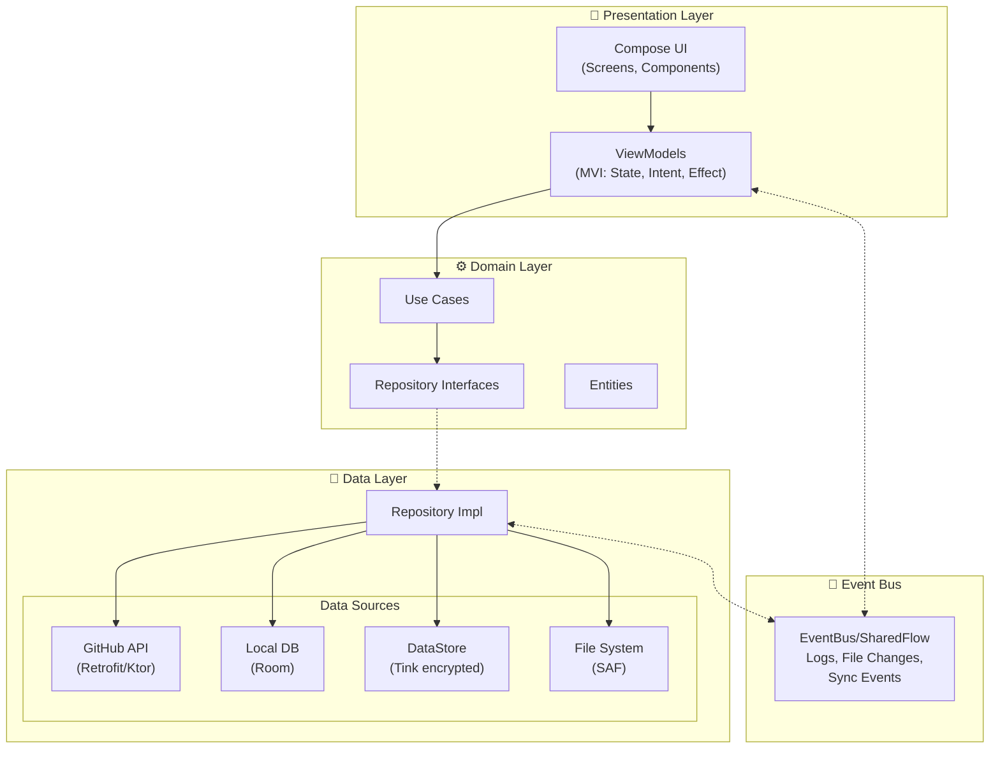
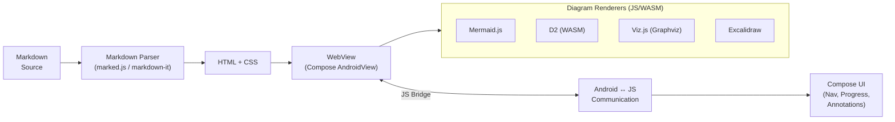
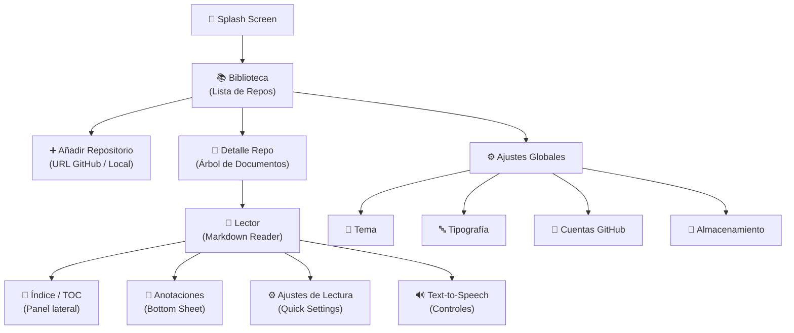
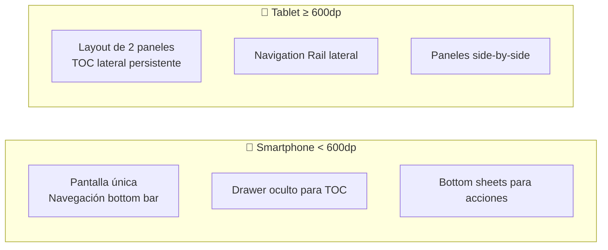
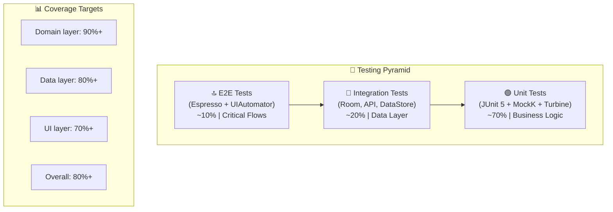
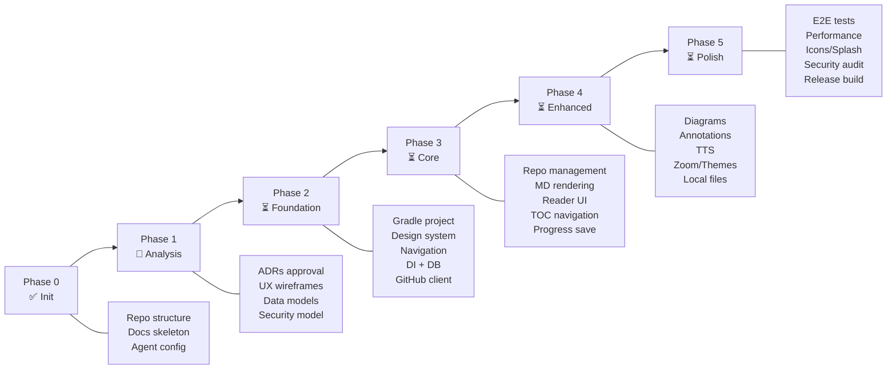

# 📋 Fase 1: Análisis — MD GitHub Navigator

> **Fecha:** 2026-10-18
> **Estado:** En revisión — Pendiente de aprobación del usuario
> **Metodología:** SSD (Specification-Driven Development)

---

## 1. Resumen del Proyecto

**MD GitHub Navigator** es una app nativa Android que transforma repositorios de GitHub en una experiencia de lectura navegable tipo eReader para contenido Markdown. Orientada principalmente a tablets (dispositivo principal de pruebas: TCL NXTPAPER 11 Plus) pero compatible también con smartphones.

---

## 2. Decisiones Técnicas Propuestas

### 2.1 Lenguaje: **Kotlin** ✅

| Criterio | Java | Kotlin |
|----------|------|--------|
| Soporte oficial Google | Mantenimiento | **Recomendado** |
| Jetpack Compose | ❌ No soportado | ✅ Requerido |
| Null safety | Manual | **Integrado** |
| Coroutines/Flow | No nativo | **Nativo** |
| Boilerplate | Alto | **Bajo** |
| Comunidad 2026 | Decreciente | **Dominante** |

**Veredicto:** Kotlin es la única opción viable dado que Jetpack Compose requiere Kotlin.

### 2.2 UI Framework: **Jetpack Compose + Material 3**

Google ha puesto XML Views en **modo mantenimiento** (2025). Compose es el toolkit activo:

- Material 3 / Material You con Dynamic Color nativo
- Animaciones y gestos superiores (ideal para eReader)
- Previsualizaciones interactivas en Android Studio
- Árbol composable plano = mejor rendimiento vs XML anidado
- Soporte nativo para edge-to-edge, predictive back

### 2.3 Arquitectura: **Clean Architecture + MVI**



**¿Por qué MVI sobre MVVM?**
- Flujo de datos **unidireccional** → estado predecible
- Un único `State` inmutable por pantalla → sin race conditions
- `Intent` modela acciones del usuario → fácil de testear
- `Effect` para side-effects (navegación, toasts) → no se pierden
- **Event-driven** por diseño (requisito del proyecto)

### 2.4 Rendering Markdown: **Arquitectura Híbrida (WebView + Compose)**



**Justificación:** Todos los motores de diagramas (Mermaid, D2, Graphviz, Excalidraw) requieren JavaScript/WASM. Un WebView es la solución más práctica y probada. La UI de navegación, controles y overlays será Compose nativo.

**Librerías JS a bundlear en assets:**
| Librería | Formato | Tamaño aprox. |
|----------|---------|---------------|
| marked.js / markdown-it | JS | ~50 KB |
| highlight.js | JS + CSS | ~300 KB |
| Mermaid.js | JS | ~1.5 MB |
| Viz.js (Graphviz) | WASM + JS | ~1.2 MB |
| D2 | WASM | ~2 MB |
| Excalidraw (renderer) | JS | ~500 KB |
| KaTeX (math) | JS + CSS | ~400 KB |

### 2.5 Compatibilidad Android

| Parámetro | Valor | Cobertura |
|-----------|-------|-----------|
| `minSdk` | **24** (Android 7.0) | ~99% dispositivos |
| `targetSdk` | **36** (Android 16) | Última versión |
| `compileSdk` | **36** | Última API |

### 2.6 Stack Tecnológico Completo

| Categoría | Librería | Propósito |
|-----------|----------|-----------|
| **DI** | Hilt (Dagger) | Inyección de dependencias |
| **Network** | Retrofit + OkHttp / Ktor | GitHub API REST |
| **Serialization** | Kotlinx Serialization | JSON parsing |
| **Database** | Room | Persistencia local |
| **Preferences** | Jetpack DataStore | Configuración no sensible |
| **Security** | Google Tink + Android Keystore | Credenciales cifradas |
| **Images** | Coil (Compose) | Carga y cache de imágenes |
| **Navigation** | Compose Navigation + Type-safe routes | Navegación entre pantallas |
| **Testing** | JUnit 5, MockK, Turbine, Compose Testing | Tests unitarios y UI |
| **E2E** | Espresso + UIAutomator | Tests end-to-end |
| **Lint** | ktlint + detekt | Análisis estático |
| **Build** | Gradle Kotlin DSL + Version Catalogs | Build system |

---

## 3. Propuestas UX / Diseño

### 3.1 Temas Propuestos

Se proponen **3 temas base** con Material 3 Dynamic Color:

#### Tema A: "Scholar" (Académico)
- **Concepto:** Inspirado en libros académicos y readers tipo Kindle
- **Colores:** Tonos cálidos (sepia, ámbar, marrón oscuro)
- **Tipografía:** Serif para lectura (Merriweather/Literata), Sans para UI (Inter)
- **Sensación:** Sobria, profesional, orientada a lectura prolongada
- **Ideal para:** La pantalla paper-like del TCL NXTPAPER

#### Tema B: "Neon Dev" (Desarrollador)
- **Concepto:** Inspirado en IDEs y terminales modernas
- **Colores:** Fondo oscuro, acentos vibrantes (cyan, magenta, verde)
- **Tipografía:** Monospace para código (JetBrains Mono), Sans para texto
- **Sensación:** Moderna, técnica, para desarrolladores
- **Ideal para:** Modo oscuro, repositorios de código

#### Tema C: "Paper" (Minimalista) — ⭐ Recomendado como default
- **Concepto:** Inspirado en la simplicidad de Medium/Notion
- **Colores:** Blancos cálidos, grises suaves, un solo accent color
- **Tipografía:** System default adaptable, excelente legibilidad
- **Sensación:** Limpia, sin distracciones, foco en contenido
- **Ideal para:** Uso general, primera impresión

### 3.2 Plantilla de Navegación



### 3.3 Patrones UX eReader

Inspirados en Kobo, Kindle, Apple Books:

| Feature | Implementación |
|---------|---------------|
| **Progreso de lectura** | Barra mínima inferior + % + tiempo estimado |
| **Cambio de página** | Swipe horizontal con animación sutil |
| **Índice (TOC)** | Panel lateral deslizable (Drawer) con cache |
| **Marcadores** | Tap esquina superior derecha (dog-ear animado) |
| **Anotaciones** | Long-press → toolbar flotante (colores + nota) |
| **Zoom imágenes** | Pinch-to-zoom + doble tap + visor fullscreen |
| **Modo inmersivo** | Tap centro → toggle barras (fade in/out) |
| **Barra de brillo** | Swipe vertical borde izquierdo |
| **Ajuste fuente** | Swipe vertical borde derecho o quick settings |
| **Búsqueda** | Barra de búsqueda con highlight de resultados |

### 3.4 Responsive Layout (Tablet vs Phone)



Compose Adaptive Layout con `WindowSizeClass`:
- **Compact** (< 600dp): Navegación bottom bar, drawer TOC, bottom sheets
- **Medium** (600-840dp): Navigation rail, TOC panel colapsable
- **Expanded** (> 840dp): Dual pane permanente (TOC + Reader)

---

## 4. Seguridad

### 4.1 Modelo de Amenazas

| Amenaza | Mitigación |
|---------|-----------|
| Token GitHub comprometido | Cifrado Tink + Android Keystore (TEE/StrongBox) |
| Man-in-the-middle | TLS 1.3 + Certificate Pinning (OkHttp) |
| Reverse engineering del APK | R8 minification + no secrets en código |
| Backup leak de tokens | `android:allowBackup="false"` para datos sensibles |
| WebView injection | CSP headers + no evaluateJavascript con input sin sanitizar |
| Logs sensibles en producción | Stripping de headers Authorization en release |
| Storage de anotaciones | Cifrado opcional de notas sensibles |

### 4.2 Autenticación GitHub

**Opción recomendada:** OAuth Device Flow
- No requiere redirect URI (ideal para apps nativas)
- Token con scopes mínimos (solo `repo:read`, `read:user`)
- Tokens expirables y revocables
- Alternativa: Fine-grained Personal Access Tokens

### 4.3 Network Security Config

```xml
<!-- network_security_config.xml -->
<network-security-config>
    <base-config cleartextTrafficPermitted="false">
        <trust-anchors>
            <certificates src="system" />
        </trust-anchors>
    </base-config>
    <domain-config>
        <domain includeSubdomains="true">api.github.com</domain>
        <domain includeSubdomains="true">raw.githubusercontent.com</domain>
        <pin-set expiration="2027-01-01">
            <!-- GitHub API certificate pins -->
        </pin-set>
    </domain-config>
</network-security-config>
```

---

## 5. Testing Strategy



### Tests E2E prioritarios:
1. Añadir un repositorio GitHub → navegar → leer documento
2. Cambiar tema → verificar persistencia
3. Crear anotación → cerrar app → verificar persistencia
4. Text-to-speech → play/pause/stop
5. Zoom en imagen → verificar gestos
6. Navegación offline (contenido cacheado)

---

## 6. Puntos Adicionales Propuestos por el Agente

> [!IMPORTANT]
> Estos son puntos que **no se mencionaron** en los requisitos pero considero esenciales:

### 6.1 🌐 Soporte Offline / Cache
- **Cache de repositorios** descargados para lectura sin conexión
- Sincronización inteligente (solo cambios, via GitHub API ETags)
- Indicador visual de contenido offline vs online
- Configuración de tamaño máximo de cache

### 6.2 🔍 Búsqueda Global
- Búsqueda full-text dentro de documentos (FTS de Room)
- Búsqueda entre todos los repositorios
- Historial de búsquedas reciente

### 6.3 📊 Estadísticas de Lectura
- Tiempo total de lectura por documento/repositorio
- Documentos completados vs pendientes
- Gráfico de actividad de lectura (como GitHub contributions)

### 6.4 📤 Exportación de Anotaciones
- Exportar anotaciones y highlights a Markdown
- Compartir anotaciones vía Android share sheet
- Formato compatible con Obsidian/Notion

### 6.5 🔗 Deep Links
- Abrir la app directamente desde URLs de GitHub
- Esquema `mdnav://` para links internos
- Android App Links verificados

### 6.6 ♿ Accesibilidad
- TalkBack completo para lectores de pantalla
- Navegación por teclado/gamepad
- Escalado de texto sin romper layouts
- Contraste WCAG AA mínimo

### 6.7 🔄 Sync & Backup
- Exportar/importar configuración completa
- Backup de anotaciones y progreso de lectura
- Opcional: sincronización entre dispositivos (Google Drive)

### 6.8 📦 Gestión de Almacenamiento
- Panel de uso de espacio por repositorio
- Limpieza de cache selectiva
- Alerta de espacio bajo

### 6.9 🧩 Soporte de Formatos Adicionales
- **AsciiDoc** (popular en repos técnicos)
- **reStructuredText** (documentación Python)
- **LaTeX/KaTeX** (ecuaciones matemáticas) — ya incluido arriba
- **PlantUML** (diagramas UML alternativos)

### 6.10 🔔 Notificaciones de Actualizaciones
- Opción de monitorizar repositorios para cambios
- Notificación cuando un documento se actualiza
- Badge en la biblioteca para repositorios con cambios

### 6.11 🎨 Personalización Avanzada
- CSS personalizado por repositorio
- Temas importables/exportables
- Gestos configurables

### 6.12 📋 Widget de Android
- Widget de "Continuar Leyendo" en home screen
- Acceso rápido al último documento

### 6.13 🖼️ Documentación de Usuario con Ejemplos Gráficos
- **Capturas de pantalla reales y mockups de interfaz:** Toda la guía de usuario (`/docs/es/user-guide/` y `/docs/en/user-guide/`) debe incluir ejemplos visuales enriquecidos para cada flujo clave (instalación, añadir repositorios, navegación TOC, lectura con eReader, notas y personalización).
- **Cobertura multidispositivo:**
  - **Tablet (TCL NXTPAPER 11 Plus):** Vistas panorámicas con dos paneles (TOC permanente a la izquierda + lector a la derecha).
  - **Smartphone:** Vistas compactas mostrando drawers deslizables y hojas inferiores (bottom sheets).
- **Recursos gráficos complementarios:**
  - Mockups con marco de dispositivo y resaltes gráficos (flechas, llamadas visuales).
  - Diagramas de navegación y tablas explicativas ilustradas.
  - Almacenamiento organizado de activos gráficos en `docs/assets/images/user-guide/`.

### 6.14 🌐 Soporte Multi-idioma / Internacionalización (i18n) — (Fase 4 / v0.4.0)
- **Resolución dinámica de idioma:**
  - **Por defecto:** Adopta el idioma del sistema operativo del dispositivo.
  - **Fallback predeterminado:** Inglés (`en`), ubicado en el conjunto de recursos base (`res/values/strings.xml`). Si el dispositivo tiene configurado un idioma sin traducción directa (ej. francés, alemán, chino), la app se mostrará automáticamente en inglés.
  - **Idiomas iniciales de lanzamiento:**
    1. **Español (`es`):** Recursos en `res/values-es/strings.xml`.
    2. **Inglés (`en`):** Recursos base en `res/values/strings.xml`.
- **Selector de idioma in-app:**
  - Configurable desde la pantalla de *Ajustes (`:feature:settings`)* para permitir al usuario fijar un idioma independiente del sistema.
  - Compatible con las APIs de preferencia de idioma por aplicación de Android 13+ (`LocaleManager` / `AppCompatDelegate.setApplicationLocales`).
- **Externalización estricta de textos:** Cero cadenas de texto hardcodeadas en Compose/Kotlin; todo texto visible de la interfaz se externaliza mediante `stringResource(R.string.*)` en los módulos de presentación (`:feature:*` y `:core:designsystem`).

---

## 7. Plan de Fases



---

## 8. Decisiones Pendientes (Requieren tu Input)

> [!WARNING]
> Los siguientes puntos necesitan tu decisión antes de continuar:

| # | Decisión | Opciones | Recomendación |
|---|----------|----------|---------------|
| 1 | **Tema por defecto** | A) Scholar, B) Neon Dev, C) Paper | C) Paper |
| 2 | **DI Framework** | Hilt (Google official) vs Koin (lightweight) | Hilt |
| 3 | **HTTP Client** | Retrofit + OkHttp vs Ktor Client | Retrofit (más maduro) |
| 4 | **Auth GitHub** | OAuth Device Flow vs PAT manual | OAuth Device Flow |
| 5 | **Cache offline** | ¿Incluir desde Phase 3 o Phase 4? | Phase 3 |
| 6 | **Formatos extra** | ¿Incluir AsciiDoc/RST o solo Markdown? | Solo Markdown (v1) |
| 7 | **Puntos 6.1-6.12** | ¿Cuáles incluir en v1.0? | 6.1, 6.2, 6.6, 6.8 |
| 8 | **Licencia** | MIT, Apache 2.0, GPL v3 | Apache 2.0 |
| 9 | **Package name** | `com.laralbir.mdghnavigator` ¿ok? | ✅ |
| 10 | **Android SDK setup** | ¿Configurar ANDROID_HOME en .zshrc? | Sí |
