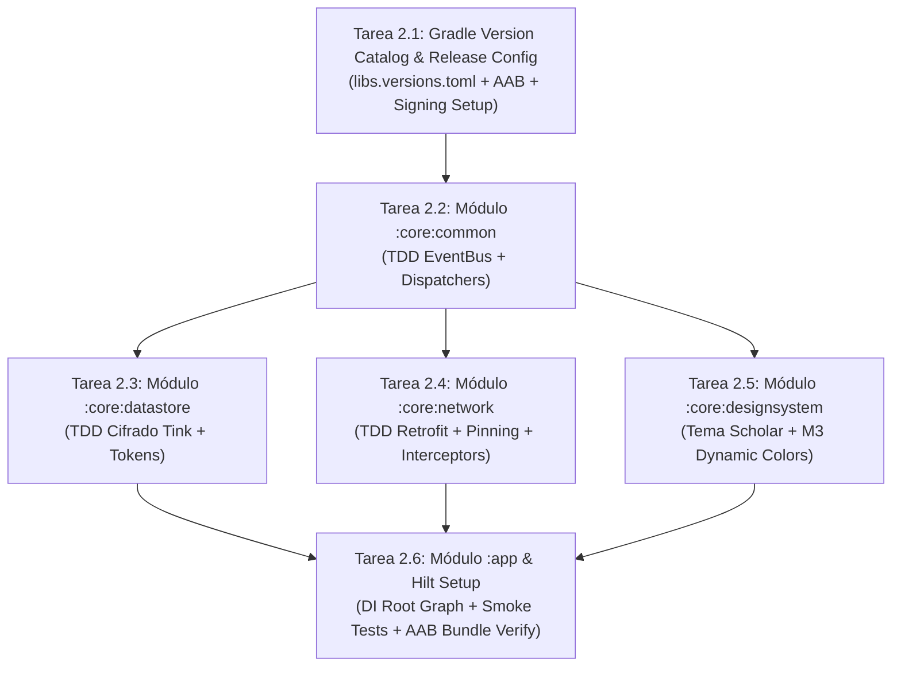

# 🛠️ Fase 2: Plan de Implementación (Foundation & Scaffolding)

> **Estado:** Propuesto — Pendiente de validación para proceder a la ejecución TDD
> **Metodología:** SSD (Specification-Driven Development) & TDD (Test-Driven Development)
> **Rama de trabajo recomendada:** `develop` (Git Flow)

---

## 1. Objetivos de la Fase 2

Construir los cimientos técnicos de la aplicación para que todos los módulos y agentes de IA puedan trabajar de forma modular y en paralelo sin interferencias:
1. **Configuración del sistema de construcción Gradle** con Kotlin DSL y catálogo de versiones centralizado (`gradle/libs.versions.toml`).
2. **Scaffolding modular** (:app, módulos :core y módulos :feature).
3. **Infraestructura de pruebas TDD** (JUnit 5, MockK, Turbine, Compose Testing) con suite base y verificación continua.
4. **Capa base de Seguridad** (Google Tink, Android Keystore, `network_security_config.xml`).
5. **EventBus reactivo** para logs y eventos del sistema de archivos.
6. **Entorno de Publicación en Google Play**: Configuración de firma desacoplada (release signing config), soporte de App Bundle (`.aab`), optimización R8/ProGuard con volcado de mappings y preparación para Play App Signing.

---

## 2. Estructura Modular del Proyecto

```
md-gh-navigator/
├── gradle/
│   └── libs.versions.toml          # Catálogo centralizado de versiones y dependencias
├── build.gradle.kts                # Configuración raíz
├── settings.gradle.kts             # Inclusión de módulos
├── app/                            # Módulo aplicación principal (Application, MainActivity, Hilt Graph, Signing)
├── core/
│   ├── common/                     # Dispatchers, EventBus, Result, Loggers
│   ├── designsystem/               # Tema Scholar (M3), Paletas, Tipografías Literata/Inter
│   ├── network/                    # Retrofit, OkHttp, Certificate Pinning, Interceptores
│   ├── database/                   # Room DB (Repositorios, Marcadores, Anotaciones, TOC)
│   ├── datastore/                  # Tink Encrypted DataStore para Tokens y Preferencias
│   └── renderer/                   # Assets JS/WASM (Mermaid, Graphviz, D2, Excalidraw, KaTeX) + WebView Bridge
└── feature/
    ├── library/                    # UI y ViewModels de biblioteca y selector de repos/carpetas
    ├── reader/                     # UI del visor eReader, control de scroll, progreso
    ├── navigator/                  # Tabla de contenidos (TOC), índice y buscador
    ├── annotations/                # Notas, subrayados y exportador
    ├── settings/                   # Ajustes visuales, tipografía, gestor de caché
    └── tts/                        # Text-to-Speech nativo de Android
```

---

## 3. Plan de Tareas Granulares (TDD Roadmap)



### Hito 2.1 — Gradle, Version Catalog & Dual Release Setup (Google Play & GitHub)
- Crear `gradle/libs.versions.toml` con versiones estables y compatibles con Android API 36 y Java 25 / Kotlin 2.x.
- Generar script de construcción raíz `build.gradle.kts` y `settings.gradle.kts`.
- Configurar signing configs para release mediante variables de entorno o `secrets.properties` (excluido en git), garantizando compatibilidad con Google Play App Signing (.aab) y firma de APKs standalone universales.
- Implementar la lógica de versionado semántico en Gradle derivando automáticamente `versionName` y `versionCode` desde los Git tags (`vMAJOR.MINOR.PATCH`).
- Definir workflow base de GitHub Actions (`.github/workflows/release.yml`) para compilación y publicación automatizada al pushear tags `v*`.

### Hito 2.2 — Módulo `:core:common` (Enfoque TDD)
- **Test primero (`EventBusTest.kt`):** Probar emisión y recolección de eventos concurrentes (`AppEvent.FileChanged`, `AppEvent.LogMessage`).
- **Implementación:** `EventBusImpl` respaldado por `MutableSharedFlow(replay = 0, extraBufferCapacity = 64)`.

### Hito 2.3 — Módulo `:core:datastore` & Seguridad (Enfoque TDD)
- **Test primero (`EncryptedTokenStorageTest.kt`):** Probar almacenamiento y recuperación de tokens cifrados, garantizando que el texto en claro no se escribe en disco.
- **Implementación:** `TinkEncryptedDataStore` integrando Keystore de Android.

### Hito 2.4 — Módulo `:core:network` (Enfoque TDD)
- **Test primero (`AuthInterceptorTest.kt`, `RateLimitInterceptorTest.kt`):** Validar inyección segura de cabeceras Bearer y tratamiento de límites de tasa de GitHub con MockWebServer.
- **Implementación:** Clientes Retrofit y OkHttp con `CertificatePinner` y `network_security_config.xml`.

### Hito 2.5 — Módulo `:core:designsystem`
- Definición de temas M3: **Scholar** (paleta cálida/sepia para TCL NXTPAPER), **Paper** y **Neon Dev**.
- Tipografías y soporte de modo claro/oscuro.

---

## 4. Estrategia de Ejecución Paralela con Subagentes

Cuando demos comienzo a la Fase 2, podemos distribuir las tareas concurrentemente entre subagentes de Antigravity:
- **Subagente A (Build, SemVer & Dual Distribution):** Generación de `libs.versions.toml`, configuraciones Gradle, lógica de versionado por Git tags, firma y soporte tanto de App Bundle (.aab) como de APK universal.
- **Subagente B (Seguridad & Datastore):** Implementación TDD de Tink y DataStore cifrado.
- **Subagente C (Design System & Theme):** Creación de los tokens de color y tipografía del tema Scholar.

---

## 5. Criterios de Aceptación de la Fase 2

1. `./gradlew assembleDebug` compila limpiamente sin advertencias críticas.
2. `./gradlew bundleRelease` genera un Android App Bundle (`.aab`) válido y optimizado con R8.
3. `./gradlew assembleRelease` genera un APK standalone universal (`.apk`) instalable directamente sin Google Play.
4. El versionado en Gradle calcula deterministamente `versionName` y `versionCode` a partir de tags SemVer (`vX.Y.Z`).
5. `./gradlew test` ejecuta con éxito el 100% de los tests unitarios creados en TDD.
6. El módulo de seguridad verifica que los tokens se almacenan cifrados con hardware Keystore y que el tráfico cleartext está completamente bloqueado.
7. El EventBus propaga eventos entre componentes desacoplados de forma reactiva.
