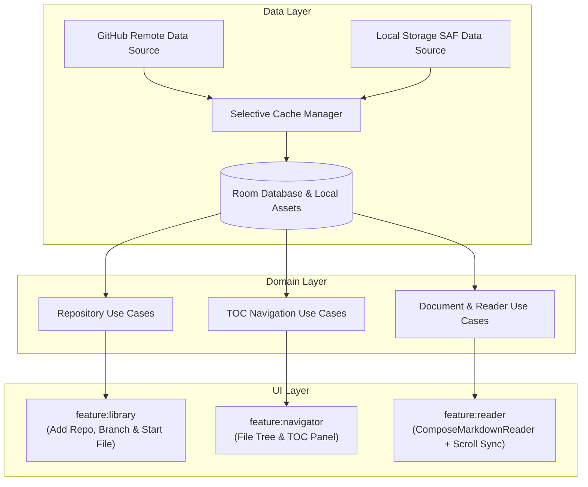

# 📖 Fase 3: Plan de Implementación (Funcionalidades Core: Lectura y Repositorios)

> **Estado:** Listo para Ejecución TDD  
> **Metodología:** SSD (Specification-Driven Development) & TDD (Test-Driven Development)  
> **Rama base de integración:** `develop` (Git Flow)  

---

## 1. Objetivos de la Fase 3

Hacer plenamente funcional el flujo principal de lectura:
1. **Conexión y Sincronización:** Descarga de contenidos desde GitHub (API v3 con ETag y autenticación condicional) y carpetas locales (Storage Access Framework).
2. **Caché Offline Selectivo:** Almacenamiento local exclusivo de ficheros `.md` y sus assets referenciados directamente (imágenes/diagramas), ignorando binarios y compilados para ahorrar espacio.
3. **Gestión de Biblioteca (`:feature:library`):** Añadir repositorios GitHub, selector de rama y selección de fichero inicial (por defecto `README.md`).
4. **Navegación e Índice TOC (`:feature:navigator`):** Explorador de archivos del repo y panel desplegable / Drawer / Split-pane con los encabezados del documento actual.
5. **Lector Adaptativo (`:feature:reader`):** Lienzo de lectura con motor WebView local, control de progreso de scroll en tiempo real, persistencia en Room y disposición adaptativa para tablet TCL NXTPAPER 11 Plus (dos paneles: TOC permanente + contenido) y smartphones.

---

## 2. Diagrama de Flujo y Componentes

---

## 3. Desglose de Hitos y Tareas TDD

### Hito 3.1 — Capa de Datos: Repositorios y Caché Selectivo (`feature/core-repository-cache`)
- [ ] **TDD:** Tests unitarios de `GitHubContentRepository` con MockWebServer y simulación de cabeceras ETag (`304 Not Modified`).
- [ ] **TDD:** Tests de `SelectiveCacheManager` verificando que solo los archivos con extensión `.md`, `.markdown` e imágenes referenciadas en enlaces locales se descargan al almacenamiento privado de la app.
- [ ] Implementación de `LocalDirectoryRepository` integrando `DocumentsContract` / SAF de Android.

### Hito 3.2 — Feature Library: Gestión de Repositorios (`feature/library-management`)
- [ ] **TDD:** ViewModel test de `LibraryViewModel` (estados MVI: `Loading`, `Empty`, `Success`, `Error`).
- [ ] Diálogo / Pantalla para agregar repositorio GitHub (propietario/nombre, rama opcional, selector de archivo raíz con valor predeterminado `README.md`).
- [ ] Selector de carpetas de almacenamiento local del dispositivo.
- [ ] Listado de repositorios guardados con indicadores de estado de sincronización y fecha de última lectura.

### Hito 3.3 — Feature Navigator: Tabla de Contenidos y Árbol de Archivos (`feature/navigator-toc`)
- [ ] **TDD:** Parser y sincronizador de encabezados (`TocSyncManagerTest`).
- [ ] Componente `TocDrawer` / `TocSidebar` que resalta el encabezado actual según el progreso de scroll.
- [ ] Explorador navegable del árbol de archivos Markdown del repositorio.

### Hito 3.4 — Feature Reader: Experiencia de Lectura eReader (`feature/reader-experience`)
- [ ] **TDD:** ViewModel test de `ReaderViewModel` verificando la persistencia inmediata de `scrollProgress` y `scrollY` al desplazarse.
- [ ] Integración de `ComposeMarkdownReader` con la barra de progreso `ReadingProgressBar` y `MdTopAppBar`.
- [ ] Disposición adaptativa con `computeReaderWindowLayout`:
  - **Tablet (TCL NXTPAPER 11 Plus):** Vista dividida permanente (30% TOC / 70% lectura) con margen ergonómico centrado.
  - **Smartphone:** Vista de una sola columna con TOC accesible vía Navigation Drawer o BottomSheet.
- [ ] Manejo de clics en enlaces:
  - Enlace web externo: Abrir en navegador externo / Custom Tabs.
  - Enlace relativo `.md`: Cargar automáticamente el nuevo documento en el lector.
  - Enlace `#ancla`: Desplazamiento suave dentro del documento.

---

## 4. Criterios de Aceptación de la Fase 3

1. Capacidad de añadir un repositorio público o privado de GitHub (usando token seguro) y un directorio local de Android.
2. Descarga y caché selectivo de Markdown e imágenes, permitiendo la lectura offline tras la primera sincronización.
3. El lector abre por defecto `README.md` (o el archivo seleccionado como principal).
4. El progreso de scroll se persiste en Room y se restaura fielmente al reabrir el documento.
5. En la tablet TCL NXTPAPER 11 Plus en horizontal se muestra la vista dividida de dos paneles; en teléfonos se colapsa a panel desplegable.
6. Todos los tests unitarios pasan al 100% con `./gradlew test`.
