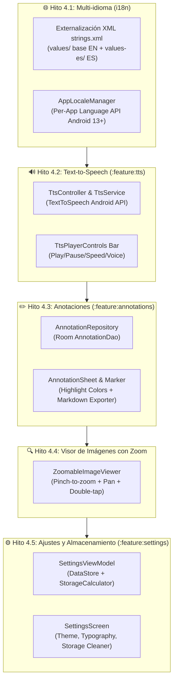

# 📖 Fase 4: Plan de Implementación (Experiencia eReader & Herramientas Avanzadas)

> **Estado:** Listo para Ejecución TDD  
> **Metodología:** SSD (Specification-Driven Development) & TDD (Test-Driven Development)  
> **Rama base de integración:** `develop` (Git Flow)  

---

## 1. Objetivos de la Fase 4

Llevar la experiencia de lectura a un nivel profesional tipo eReader (Kobo, Nickel, Kindle) e incorporar herramientas avanzadas:
1. **Internacionalización (i18n):** Idioma del sistema por defecto con fallback a inglés (`res/values/strings.xml`), traducciones completas en español (`res/values-es/strings.xml`) y selector de idioma por app (Android 13+ `LocaleManager`).
2. **Motor Text-to-Speech (TTS) (`:feature:tts`):** Lectura por voz de párrafos Markdown en segundo plano, control de reproducción (play/pause/stop), selección de velocidad y voces descargables de Android.
3. **Anotaciones y Resaltados (`:feature:annotations`):** Selección de fragmentos de texto, colores de resaltado, notas al pie asociadas, persistencia en Room y exportación a archivos `.md`.
4. **Visor de Imágenes Interactivo:** Detección de clics en imágenes o diagramas del WebView para abrirlas a pantalla completa con soporte táctil de zoom (pinch-to-zoom, arrastre y doble toque para restablecer).
5. **Ajustes y Almacenamiento (`:feature:settings`):** Configuración de tipografía (Literata vs Inter), tamaño de fuente, interlineado, selector de tema, medidor de espacio en disco de repositorios y limpieza de caché selectiva.

---

## 2. Desglose de Hitos y Tareas TDD

---

### Hito 4.1 — Internacionalización y Localización (i18n) (`feature/i18n-localization`) ✅
- [x] **TDD:** Test unitario verificando la resolución de claves de recursos y fallback de idioma (`StringResourcesParityTest`).
- [x] Creación de `core/designsystem/src/main/res/values/strings.xml` (Inglés base) y `res/values-es/strings.xml` (Español).
- [x] Externalización de todas las cadenas de `:feature:library`, `:feature:reader`, `:feature:navigator`, `:feature:tts`, `:feature:annotations` y `:app`.
- [x] Implementación de `AppLocaleManager` para cambio dinámico de idioma in-app en Android 13+ con retrocompatibilidad.

### Hito 4.2 — Motor Text-to-Speech (`feature/reader-tts`) ✅
- [x] **TDD:** Tests unitarios de `TtsController` y `MarkdownSpeechCleaner` con simulación de estados (reproduciendo, pausado, detenido, velocidad).
- [x] Implementación de `DefaultTtsController` encapsulando `android.speech.tts.TextToSpeech`:
  - Limpieza de Markdown sintáctico para habla fluida sin sintaxis cruda ni bloques de código.
  - Selección de velocidad (`speechRate`: 0.5x a 2.0x).
- [x] Componente Compose `TtsPlayerBar` incrustado como barra inferior en `ReaderScreen` y botón en TopAppBar.

### Hito 4.3 — Sistema de Marcadores, Anotaciones y Resaltados (`feature/reader-annotations-bookmarks`) ✅
- [x] **TDD:** Tests unitarios de `AnnotationDao`, `AnnotationsViewModel` y `MarkdownAnnotationExporter`.
- [x] Persistencia en Room (`AppDatabase` v2) con `AnnotationType` (`BOOKMARK`, `HIGHLIGHT`, `NOTE`), `scrollProgress` y `scrollY`.
- [x] Diálogo `AddBookmarkDialog` para guardar rápidamente la posición de lectura actual con título y nota opcional.
- [x] Panel unificado `UnifiedAnnotationsDrawer` (split-pane en tablets NXTPAPER y cajón modal en teléfonos) con pestañas y contadores.
- [x] Navegación rápida con un toque mediante evaluación de `window.ReaderApi.scrollToProgress()`.
- [x] Exportador estructurado `MarkdownAnnotationExporter` y compartición nativa mediante Android Share sheet (`ACTION_SEND`).

### Hito 4.4 — Visor de Imágenes con Pinch-to-Zoom (`feature/reader-image-viewer`) ✅
- [x] Componente `ZoomableImageViewer`: modal a pantalla completa con gestos multitáctiles (`detectTransformGestures`) para zoom suave de 1x a 5x, desplazamiento (pan) y doble toque para ampliar o restablecer (`ZoomState`).
- [x] Detección de clics en etiquetas `` y diagramas SVG dentro del WebView Markdown y apertura automática del visor interactivo vía `ReaderBridge`.
- [x] Barra superior táctil con indicador de zoom porcentual, botones de zoom in/out, botón de restablecer zoom y botón de cerrar.

### Hito 4.5 — Pantalla de Ajustes y Gestor de Caché (`feature/reader-settings`) ✅
- [x] **TDD:** Tests de `SettingsViewModel` para persistencia de tema, tipografía y selector de idioma.
- [x] Medidor de almacenamiento: cálculo del tamaño en MB utilizado por cada repositorio en la caché privada de la app (`StorageManager`).
- [x] Botón de limpieza selectiva de caché de imágenes y documentos antiguos no marcados como favoritos.
- [x] Integración de ruta `"settings"` en Navigation Compose desde la `MdTopAppBar` y barra lateral.

---

## 3. Criterios de Aceptación de la Fase 4

1. La app se adapta al idioma del sistema y permite forzar Español o Inglés desde Ajustes, cayendo en inglés ante cualquier idioma no traducido.
2. El lector lee párrafos mediante TTS con controles de pausar, reanudar y saltar.
3. El usuario puede resaltar texto y guardar notas que persisten entre sesiones en Room y se pueden exportar a un fichero `.md`.
4. Las imágenes y diagramas pueden ampliarse con gestos táctiles fluidos.
5. El tamaño de letra y la tipografía (Literata vs Inter) cambian instantáneamente el contenido del lector.
6. 100% de tests unitarios pasando en `./gradlew test`.
