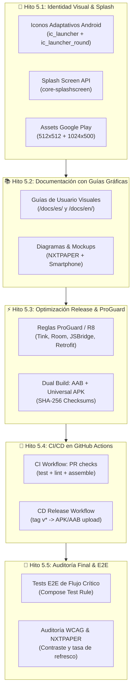

# 🚀 Fase 5: Plan de Implementación (Pulido, Recursos Gráficos y Distribución)

> **Estado:** Propuesto / Listo para Ejecución  
> **Metodología:** SSD (Specification-Driven Development) & TDD (Test-Driven Development)  
> **Rama base de integración:** `develop` (Git Flow)  
> **Objetivo de Versión:** `v1.0.0` (Producción)

---

## 1. Objetivos de la Fase 5

Culminar el desarrollo de **MD GitHub Navigator** preparando la aplicación para su lanzamiento a producción y distribución masiva a través de Google Play Store y GitHub Releases:

1. **Identidad Visual y Branding (`:feature:branding` / `:core:designsystem`):**
   - Iconos adaptativos de Android (`AdaptiveIcon`) con fondo mate y primer plano vectorial e-paper.
   - Pantalla de inicio Splash Screen fluida con la API `androidx.core:core-splashscreen`.
   - Assets gráficos requeridos por la consola de Google Play (icono 512x512, feature graphic 1024x500).
2. **Documentación de Usuario Enriquecida con Recursos Gráficos:**
   - Incorporar diagramas, mockups y capturas de pantalla paso a paso en `/docs/es/user-guide/` y `/docs/en/user-guide/`.
   - Especificaciones visuales para tabletas TCL NXTPAPER 11 Plus y smartphones.
3. **Optimización de Rendimiento y Empaquetado Release (R8/ProGuard):**
   - Habilitación de `isMinifyEnabled = true` e `isShrinkResources = true`.
   - Reglas de ofuscación ProGuard para Room, Tink, Retrofit y JavaScript Bridge.
   - Verificación de AAB para Google Play Store y APK universal firmado para GitHub Releases con checksums SHA-256.
4. **Automatización CI/CD con GitHub Actions:**
   - Pipeline de validación continua en PRs (`lint`, `test`, `build`).
   - Pipeline de publicación en Releases de GitHub al recibir tags `v*`.
5. **Auditoría de Rendimiento y Tests E2E de Flujo Crítico:**
   - Smoke tests end-to-end de navegación: importar repositorio -> navegar documento -> resaltar/anotar -> cambiar ajustes.
   - Validación de contraste y ergonomía visual en pantalla mate NXTPAPER.

---

## 2. Desglose de Hitos y Tareas

---

### Hito 5.1 — Identidad Visual, Iconos Adaptativos y Splash Screen (`feature/polish-branding-icons`) ✅
- [x] Definición de icono vectorial principal: isotipo de libro abierto fusionado con rama git y pantalla mate.
- [x] Generación de recursos `mipmap-anydpi-v26` (`ic_launcher.xml` e `ic_launcher_round.xml`) con `ic_launcher_background` e `ic_launcher_foreground`.
- [x] Integración de `androidx.core:core-splashscreen` en `:app` con `installSplashScreen()` en `MainActivity.kt`.
- [x] Creación de assets de marketing en `docs/assets/store/`:
  - `icon_play_512x512.png` (32-bit PNG con canal alfa).
  - `feature_graphic_1024x500.png` (banner promocional sin bordes).

### Hito 5.2 — Guía de Usuario con Recursos Gráficos y Ejemplos Paso a Paso (`feature/user-guide-graphics`)
- [ ] Generación de diagramas ilustrativos de interfaz en formato SVG/Mermaid para cada guía de usuario:
  - `adding-repositories.md`: flujo de sincronización de repositorios remotos y carpetas locales SAF.
  - `reading-navigation.md`: interacción con TOC, anclajes y gestos de zoom.
  - `annotations-bookmarks.md`: marcado de texto, notas flotantes y exportación Markdown.
  - `text-to-speech.md`: uso del reproductor nativo y velocidades.
  - `settings.md`: personalización de temas (Scholar / Paper / Neon) y limpieza de caché.
- [ ] Sincronización bilingüe completa en `/docs/es/user-guide/` y `/docs/en/user-guide/`.

### Hito 5.3 — Optimización de Release, R8/ProGuard y Firma Dual (`feature/release-optimization-signing`)
- [ ] Auditoría y ajuste de `app/proguard-rules.pro`:
  - Preservación de interfaces de `@JavascriptInterface` en `:core:renderer` (`ReaderBridge`).
  - Reglas para Google Tink y Android Keystore en `:core:datastore`.
  - Reglas de serialización KotlinX y Room DAOs en `:core:database`.
- [ ] Habilitación de `isMinifyEnabled = true` e `isShrinkResources = true` en el build type `release`.
- [ ] Tarea Gradle para generación de hash SHA-256 de los binarios compilados.
- [ ] Verificación de ejecución limpia de `./gradlew assembleRelease` y `./gradlew bundleRelease`.

### Hito 5.4 — Automatización CI/CD con GitHub Actions (`feature/ci-cd-pipelines`)
- [ ] Workflow `.github/workflows/ci.yml`:
  - Disparado en pushes y pull requests hacia `develop` y `main`.
  - Ejecuta `./gradlew lintDebug`, `./gradlew test` y `./gradlew assembleDebug`.
- [ ] Workflow `.github/workflows/release.yml`:
  - Disparado en la creación de tags que comiencen con `v*`.
  - Construye el AAB para Google Play y el APK universal firmado para GitHub Releases.
  - Publica el GitHub Release con las notas extraídas de `docs/CHANGELOG.md` y adjunta el APK con su hash SHA-256.

### Hito 5.5 — Tests E2E de Flujo Crítico y Auditoría Final (`feature/e2e-testing-audit`)
- [ ] Implementación de test de flujo de lectura end-to-end (`ReaderFlowE2ETest`).
- [ ] Verificación de contraste cromático WCAG AA en tema Scholar, Paper y Neon.
- [ ] Actualización final de `docs/CHANGELOG.md` con la versión de producción `v1.0.0`.

---

## 3. Criterios de Aceptación de la Fase 5

1. La aplicación dispone de icono adaptativo propio y pantalla splash nativa.
2. La suite completa de documentación incluye guías ilustradas con capturas y diagramas bilingües.
3. El build de release con R8/ProGuard compila sin errores y pasa todos los tests unitarios.
4. El pipeline CI/CD en GitHub Actions valida los cambios automáticamente y genera artefactos descargables.
5. 100% de tests unitarios pasando en `./gradlew test`.
