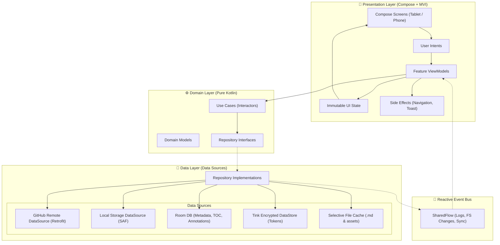

# System Architecture — MD GitHub Navigator

This document details the technical architecture, design patterns, and core components of **MD GitHub Navigator**.

---

## 1. Architectural Overview

The application follows **Clean Architecture** structured under the **MVI (Model-View-Intent)** pattern, complemented by a reactive shared event bus for logging and filesystem change propagation.



---

## 2. Core Principles

1. **Separation of Concerns:** The domain layer has zero Android SDK dependencies, enabling fast JUnit 5 + MockK unit testing.
2. **Unidirectional Data Flow (UDF):**
   - Screens dispatch **Intents** to ViewModels.
   - ViewModels execute domain use cases and emit immutable **UI State**.
   - One-shot occurrences (e.g. snackbars, toasts, navigation commands) are emitted as **Effects** via Coroutine channels.
3. **Event-Driven:** File system changes or repository syncs trigger events on a centralized `SharedFlow`, decoupling background tasks from UI listeners.
4. **Selective Offline Caching:** Persists only `.md` documents and explicitly linked media assets, strictly avoiding repository bloat.

---

## 3. Modularization

```
:app
├── :core:common          # Common utilities, Dispatchers, EventBus
├── :core:designsystem    # Scholar theme, M3 palettes, adaptive layouts
├── :core:network         # Retrofit client, interceptors, Certificate Pinning
├── :core:database        # Room database, entities, and DAOs
├── :core:datastore       # Encrypted credentials storage with Google Tink
├── :core:renderer        # Hybrid Compose-WebView engine for Markdown and diagrams
├── :feature:library      # GitHub and local repository management
├── :feature:reader       # Markdown reader, zoom, scroll position tracking
├── :feature:navigator    # File tree and Table of Contents (TOC) sidebar
├── :feature:annotations  # Highlights, notes, and Markdown exporter
├── :feature:settings     # User preferences, themes, and cache cleaner
└── :feature:tts          # Native Text-to-Speech background engine
```

---

## 4. Hybrid Rendering Engine

To render complex diagrams (**Mermaid**, **Graphviz/Viz.js**, **D2/WASM**, **Excalidraw**, and **KaTeX** math formulas), the app embeds an isolated local web view within Jetpack Compose via `AndroidView`:
- **No external CDN dependencies:** All rendering scripts reside inside the local `assets/` directory.
- **Bi-directional JavaScript Bridge (`@JavascriptInterface`):**
  - **JS -> Android:** Reports scroll percentage, hyperlink clicks, text selection, and image zoom taps.
  - **Android -> JS:** Injects active theme CSS (Scholar, Paper, Neon Dev), font scale, and scroll-to-heading commands.

---

## 5. Internationalization Strategy (i18n) — (Phase 4 / v0.4.0)

1. **Hierarchical Language Resolution:**
   - **System Default:** Android dynamically resolves strings via `stringResource(R.string.*)` matching device locale.
   - **English Fallback:** Base qualifier `res/values/strings.xml` stores all strings in English (`en`). Unmatched languages automatically fall back to English without missing key crashes.
   - **Initial Target Locales:** Spanish (`res/values-es/strings.xml`) and English (`res/values/strings.xml`).
2. **Per-App Language Preference:**
   - Supported via Android 13+ `android.app.LocaleManager` and `AppCompatDelegate.setApplicationLocales` in `:feature:settings`.
3. **Strict Text Externalization:**
   - Zero hardcoded text literals in Compose or Kotlin code; all visual labels are externalized to resource XML files.

---

## 6. Bookmarks, Annotations & Fast Navigation Panel

The persistence and display of reading anchors is centralized in `:feature:annotations` and `:core:database`:
1. **Unified Schema in Room (`AnnotationEntity`)**:
   - Covers three primary types (`AnnotationType`): `BOOKMARK` (positional bookmark), `HIGHLIGHT` (selected excerpt), and `NOTE` (user note).
   - High-precision coordinate metadata: `scrollProgress` (normalized float) and `scrollY` (absolute vertical offset in pixels).
2. **Bi-directional Asynchronous Navigation**:
   - Selecting any entry in `UnifiedAnnotationsDrawer` evaluates JavaScript `window.ReaderApi.scrollToProgress(progress)` inside the WebView, providing smooth and instant jump-to-anchor navigation.
3. **Structured Markdown Exporter**:
   - `MarkdownAnnotationExporter` transforms the ordered reading highlights and bookmarks into a clean Markdown summary for external study, directly shareable via the native Android Share sheet (`ACTION_SEND`).

---

## 7. Parallel Agent Concurrency & Deadlock Prevention (CPU/GPU)

To accelerate system development using autonomous AI agents and concurrent subagents without system lockups:
1. **Multi-Core Hardware Optimization**:
   - **CPU**: Parallel Gradle builds (`--parallel`, `--max-workers`) decoupling contention between modules (`:core:*` vs `:feature:*`).
   - **GPU**: Offload Compose layout previews, Android emulator graphics, and local neural inference pipelines.
2. **Anti-Deadlock Guarantee (Coffman Conditions)**:
   - **Isolated Workspaces**: Writing subagents operate on separate git branches or disjoint file sets.
   - **Elimination of "Hold and Wait"**: Subagents never retain exclusive shared locks while awaiting asynchronous responses.
   - **Strict DAG Topology**: Hierarchical unidirectional orchestration eliminating circular wait conditions.
   - **Event-Driven Asynchronous Messaging**: System event wakeups with defensive timeouts replacing polling loops.
