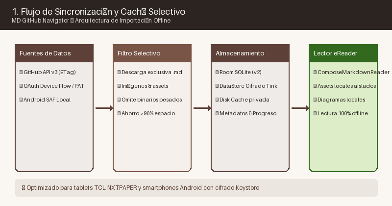
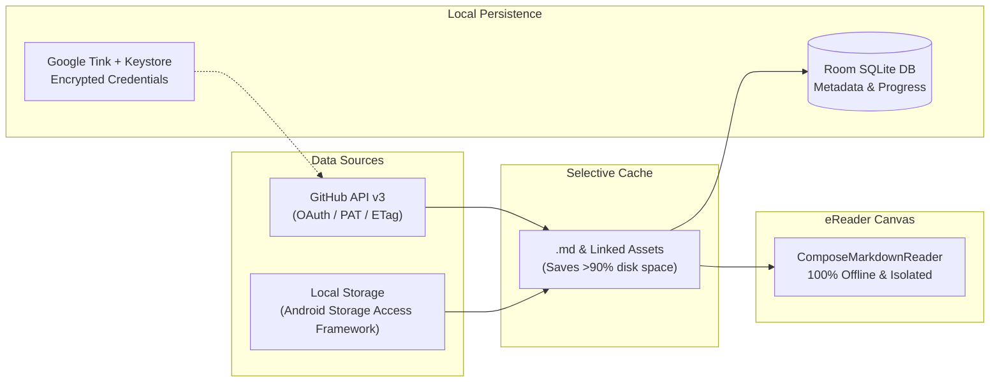

# Adding and Managing Repositories

In **MD GitHub Navigator**, you can link multiple content sources: remote GitHub repositories and local folders stored on your tablet or smartphone.

---

## 1. Connecting GitHub Repositories

To add a repository hosted on GitHub:
1. Tap the floating action button **`+ Add Repository`** on the main Library screen.
2. Enter the repository URL or slug (for example: `https://github.com/laralbir/md-gh-navigator` or `facebook/react`).
3. Select the desired branch (default is the primary branch, e.g., `main` or `master`).
4. **Initial Entrypoint File:** By default, the app selects the root `README.md`, but you can pick any `.md` file as the reading entrypoint.

### Private or Organization Repositories
If the repository is private or belongs to an organization:
- **Option A (Recommended):** Authentication via **OAuth Device Flow**. The app displays an 8-character code and opens GitHub in your browser to authorize access in seconds.
- **Option B:** Enter a **Personal Access Token (PAT)** or Fine-Grained Token with read permissions (`repo:read`).

---

## 2. Connecting Local Storage Folders

If you store personal notes or offline documentation on your device (e.g., synchronized with Syncthing or stored on internal storage):
1. In the Add Repository dialog, select the **Local Folder** tab.
2. Using Android's official file picker (Storage Access Framework), grant access to the folder containing your markdown files.
3. The app indexes all `.md` files and generates a navigation tree identical to remote repositories.

---

## 3. Selective Caching and Storage Savings

The application adheres to a strict **selective caching policy**:
- Only Markdown text files and referenced images/diagrams are downloaded to device storage.
- Heavy binaries, source archives, or directories outside documentation are skipped, saving dozens of megabytes per repository.
