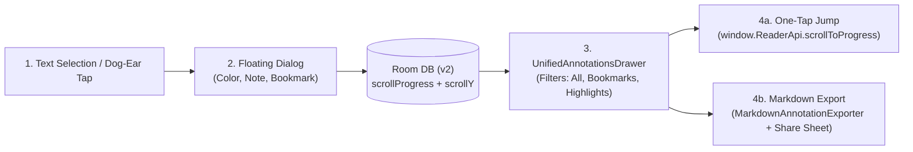

# Annotations, Highlights, and Bookmarks

**MD GitHub Navigator** allows you to actively interact with technical documentation by taking notes, highlighting essential code snippets, and saving reading bookmarks for instant navigation.

---

## 1. Fast Bookmarks

- **Top-Right Corner Gesture (Dog-Ear):** Tap the top-right corner of the reading canvas or select *Add Bookmark* from the menu to save your exact reading progress with a custom title and optional note.
- **Unified Drawer Access:** Open the Annotations drawer to inspect all saved bookmarks sorted chronologically or by document, jumping back to any position with a single tap.

---

## 2. Text Highlights and Inline Notes

- **Text Selection:** Long-press and drag your finger across any text paragraph or heading you wish to mark.
- **Floating Action Bar:**
  - **Color Palette:** Choose from 4 soft pastel colors (Scholar Warm Amber, Mint Green, Rose, or Sepia).
  - **Attach Note:** Add your personal reflections or technical clarifications to the highlight.
- **Rendering:** Highlighted spans are styled smoothly without breaking layout flow or contrast. Tapping any highlight displays its attached note in an inspector card.

---

## 3. Markdown Export and Sharing

- **Structured Markdown Exporter:** All annotations and bookmarks from the active repository can be compiled into a structured `.md` summary file.
- **Android Share Sheet Integration:** Share your notes directly to **Obsidian**, **Logseq**, **Notion**, Google Drive, or email using Android's native share sheet (`ACTION_SEND`).
