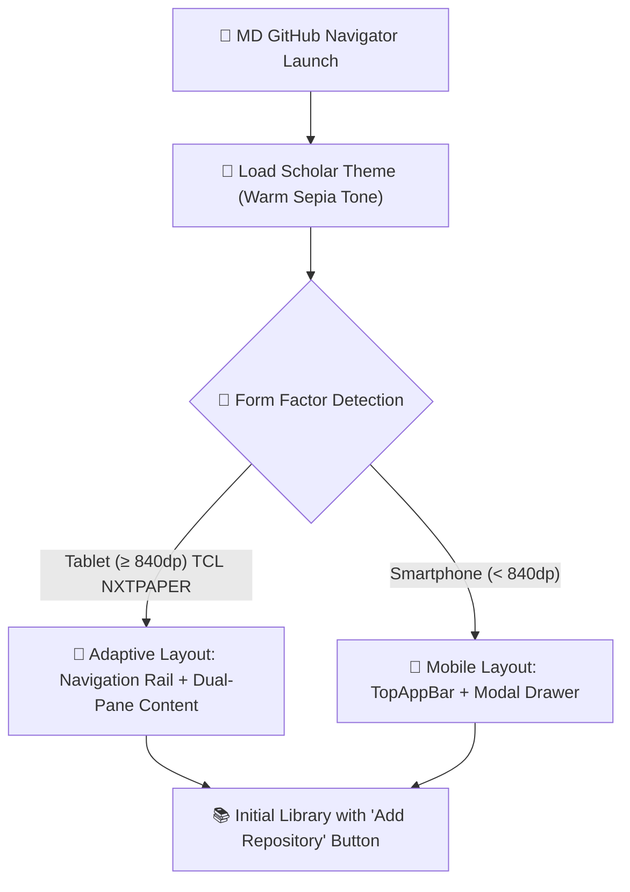

# Getting Started — MD GitHub Navigator

Welcome to **MD GitHub Navigator**, the eReader-grade reading canvas and navigation client for technical documentation, Git repositories, and Markdown books.

---

## 1. Device Requirements

- **Operating System:** Android 7.0 (API 24) or higher (optimized for Android 15/16).
- **Recommended Devices:** Eye-care and e-paper tablets (such as the TCL NXTPAPER 11 Plus) and modern Android smartphones.
- **Disk Storage:** The selective cache stores solely `.md` text files and linked images, typically consuming under 50 MB per synchronized repository.

---

## 2. Installing the Application

You can install the app through two official distribution pipelines:

### Option A: From Google Play Store
1. Search for **MD GitHub Navigator** in the Google Play Store on your device.
2. Tap **Install**. Future updates are delivered and managed automatically by Google Play.

### Option B: Direct Sideloading via GitHub Releases
Ideal for devices without Google Play services, custom ROMs, or dedicated e-readers:
1. Open the [GitHub Releases page](https://github.com/laralbir/md-gh-navigator/releases/latest).
2. Download the universal standalone APK (`app-universal-release.apk`).
3. Optional: Verify binary integrity using the provided `.sha256` checksum file.
4. Tap the downloaded file and confirm installation (allow *Install unknown apps* if prompted by Android).
5. The app includes an integrated update checker in *Settings* alerting you whenever a new release is published.

---

## 3. First Launch and Device Adaptation

*Figure 1: Tablet layout on TCL NXTPAPER 11 Plus with Scholar theme active and initial welcome cards.*

*Figure 2: Compact smartphone layout with direct access to the floating add button.*

---

## 4. Quick Navigation

- **Navigation Rail (Tablets):** Instantly switch between the *Library*, *Recent Documents*, *Bookmarks & Annotations*, and *Settings*.
- **Full-Screen Canvas:** Tap near the center of any open document to toggle the top action bar and bottom reading controls.
- **One-Tap Theme Switcher:** Tap the palette selector to alternate between *Scholar* (warm sepia paper), *Paper* (minimalist e-ink), or *Neon Dev* (high-contrast code editor).
