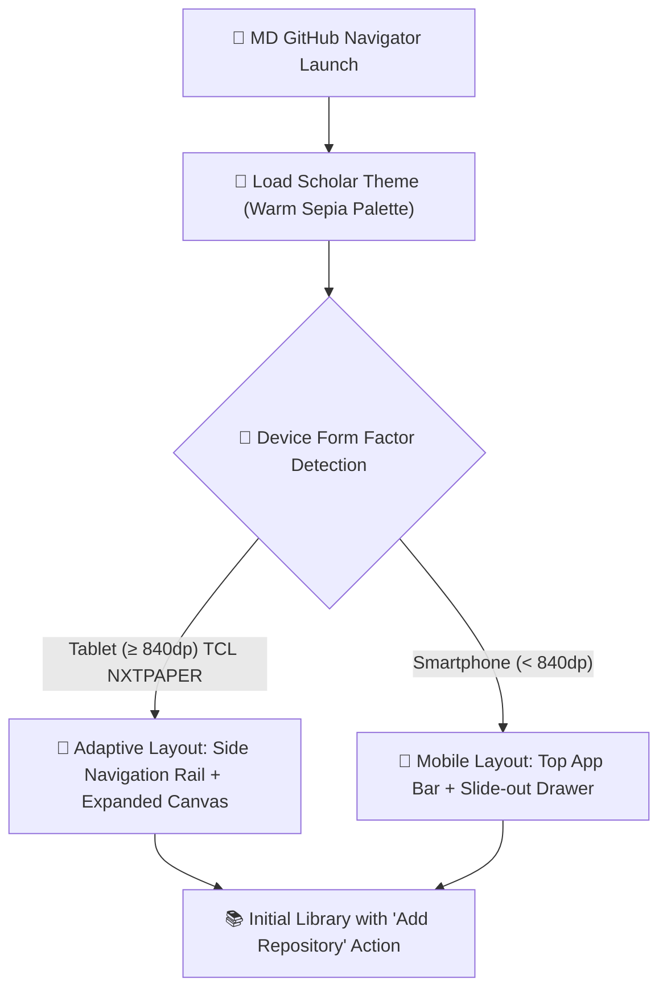

# Getting Started — MD GitHub Navigator

Welcome to **MD GitHub Navigator**, an eReader-grade document reader engineered for technical repositories and Markdown books on Android devices.

---

## 1. Device Requirements

- **Operating System:** Android 7.0 (API 24) or newer (optimized for Android 15 & 16).
- **Recommended Devices:** Tablets with ergonomic reading aspect ratios (e.g., TCL NXTPAPER 11 Plus, 11.5", 3:2) and modern smartphones.
- **Disk Footprint:** The selective cache system stores solely `.md` files and directly referenced images, typically using under 50 MB per repository.

---

## 2. Installing the Application

You can install the app through two official distribution channels:

### Option A: From Google Play Store
1. Search for **MD GitHub Navigator** in the Google Play Store on your tablet or phone.
2. Tap **Install**. Automatic background updates will be handled by the Play Store.

### Option B: Direct APK Download via GitHub Releases (Sideloading)
Ideal for devices without Google Mobile Services (GMS), custom ROMs, or dedicated e-readers:
1. Open the [GitHub Releases page](https://github.com/laralbir/md-gh-navigator/releases/latest).
2. Download `app-universal-release.apk` (or your CPU-specific architecture APK).
3. Optional: Verify download integrity with the matching `.sha256` checksum file.
4. Tap the downloaded APK to install (enable *Install unknown apps* if prompted by Android).
5. The app incorporates a built-in release checker in *Settings* alerting you when newer versions are published on GitHub.

---

## 3. First Launch & Interface Overview

Upon launching the application:
1. The warm **Scholar** theme activates by default, specifically tailored for glare-free, paper-like screens to minimize eye strain.
2. The initial screen displays an empty **Repository Library**.

### 3.1 Visual Launch Flow

*Figure 1: Tablet landscape panoramic layout on TCL NXTPAPER 11 Plus with Scholar theme active.*

*Figure 2: Compact smartphone layout with direct access via Floating Action Button.*

---

## 4. Quick Navigation

- **Navigation Rail / Bottom Bar:** Seamlessly switch between *Library*, *Recent Documents*, *Bookmarks & Annotaciones*, and *Settings*.
- **Fullscreen Reading Canvas:** Tap the center of any open document to toggle the top app bar and reading indicators.
- **One-Tap Theme Switcher:** Tap the palette icon in the top bar to alternate between *Scholar* (warm sepia), *Paper* (minimalist e-ink), or *Neon Dev* (high-contrast developer dark).
