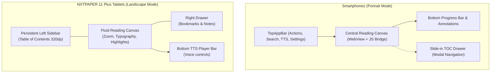

# Reading and Navigation — eReader Experience

**MD GitHub Navigator** delivers an e-ink / paper-grade reading experience optimized for both mobile smartphones and larger tablets such as the TCL NXTPAPER 11 Plus.

---

## 1. Reading Canvas and Controls

- **Immersive Mode:** Tap anywhere near the vertical center to toggle between distraction-free full-screen reading and interface bars (TopAppBar with actions and bottom reading progress bar).
- **Reading Progress Tracking:**
  - The app automatically records your current file and exact percentage scroll position inside Room database.
  - Re-opening any repository immediately resumes reading at the exact position you left off.
- **Brightness & Typography Adjustments:**
  - Swipe vertically on the left screen edge to quickly tweak screen illumination.
  - Use the Typography drawer to adjust font scale ($0.85\times$ to $1.35\times$), line spacing, and font family (Literata Serif, Inter Sans, or System).

---

## 2. Table of Contents (TOC) and Repository Tree

- **Modal Drawer (Smartphones):** Swipe from the left bezel or tap the TOC icon (📑) to open the collapsible repository file tree and document headings.
- **Dual-Pane Split Layout (Tablets / TCL NXTPAPER 11 Plus):** On tablets, the left navigation tree stays docked or toggles with one tap, enabling instantaneous chapter switching without losing reading context.
- **Offline Index Cache:** Headings and file hierarchies are cached locally in SQLite for zero-latency instant offline navigation.

---

## 3. Diagram and Image Rendering

- **Technical Diagrams:** Architectural diagrams defined in **Mermaid**, **Graphviz**, **D2**, or **Excalidraw** are converted to SVG and rendered crisply on the offline canvas.
- **Interactive Zoom Viewer:**
  - Double-tap any image or SVG diagram to open the dedicated full-screen zoomable viewer (`ZoomableImageViewer`).
  - Use smooth pinch-to-zoom gestures ($1\times$ to $5\times$) and drag gestures to pan through detailed architectural diagrams.
- **Safe Hyperlink Navigation:** External links open securely in your device's default web browser or external app.
