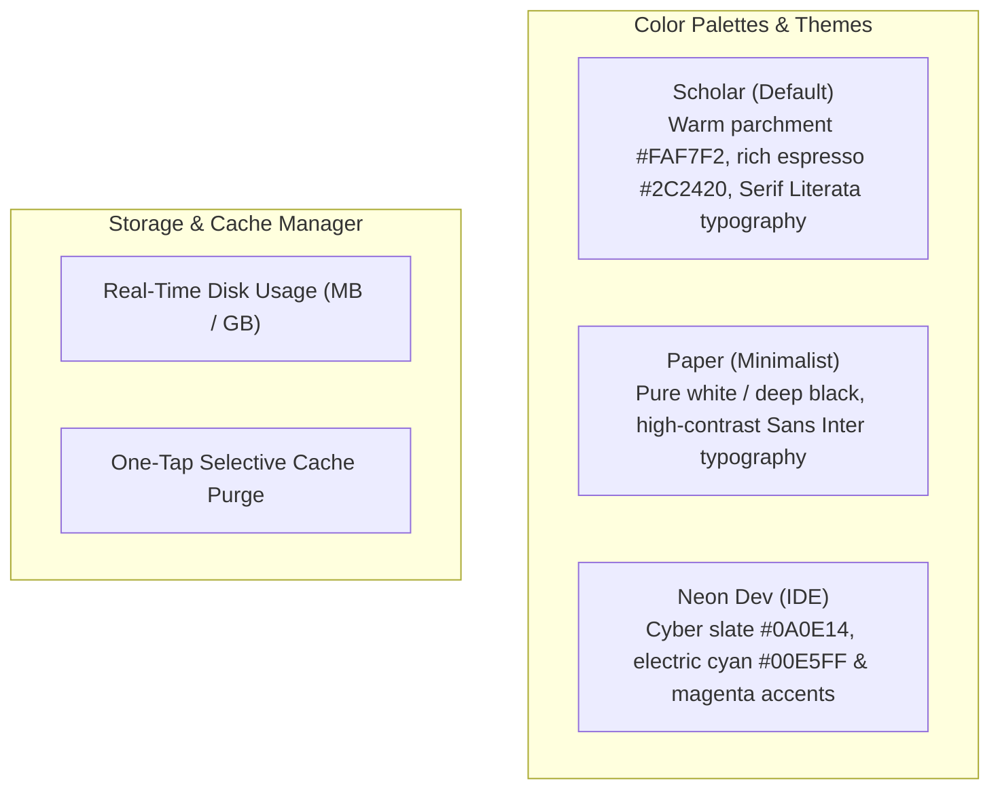

# Settings and Customization

Customize the reading atmosphere and system behaviors according to your personal preferences and device screen technology.

---

## 1. Visual Themes

- **Scholar (Default):** Engineered specifically for matte anti-glare screens like the **TCL NXTPAPER 11 Plus** and nighttime reading. Features warm parchment tones, softened contrast, and refined Serif typography.
- **Paper:** High-contrast neutral monochrome styling inspired by Notion and Medium, with crisp pure whites and deep ink blacks.
- **Neon Dev:** High-tech dark theme featuring cyber tones, cyan, and magenta highlights tailored for developers accustomed to modern IDE code syntax themes.
- **System Theme Matching:** Automatically follows Android's system-wide Dark / Light mode preference.

---

## 2. Typography and Reading Layout

- **Font Family Selection:**
  - *Serif:* Literata (optimal for long-form reading and technical books).
  - *Sans:* Inter (clean, sharp, and modern UI).
  - *System:* Uses your Android device's default system font.
- **Continuous Font Scaling:** Adjust font size from $0.85\times$ to $1.35\times$ with instant live preview.
- **Language Selector:** Seamlessly switch between Spanish, English, or System Default in-app without changing your operating system locale.

---

## 3. Storage and Cache Management

- **Storage Meter:** Computes and displays disk space consumed by cached documentation repositories in real time.
- **One-Tap Cache Cleaner:** Purge cached images and transient files with a single tap while safeguarding your saved bookmarks, highlights, and reading progress.
