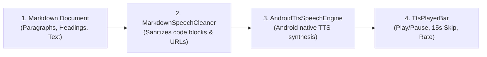

# Text-to-Speech (TTS) Voice Engine

**MD GitHub Navigator** integrates Android's native text-to-speech synthesis engine, allowing you to listen to technical books, papers, and repository documentation hands-free.

---

## 1. Starting Voice Playback

1. While inside any Markdown document, tap the audio speaker icon (🔊) on the top action bar or bottom action menu.
2. Reading starts immediately from the first visible paragraph on your screen.
3. The paragraph currently being spoken is highlighted with a gentle accent indicator, auto-scrolling smoothly as playback progresses.

---

## 2. Playback Controls

- **Interactive Bottom Player Bar:** Includes Play / Pause toggle, jump backward 15 seconds, and jump to the next heading or section.
- **Speed Rate Adjustment:** Adjust speech cadence continuously from $0.5\times$ to $2.0\times$ (default $1.0\times$).
- **Lifecycle Resilience:** Audio continues playing reliably even when scrolling or rotating the screen.

---

## 3. Voices and Language Support

- The app connects to the high-quality speech engines installed on your device (Google Speech Services / device manufacturer voice packs).
- To download offline neural voice packages or switch pronunciation accents, tap *Configure Voices* to access Android's system Text-to-Speech settings directly.
