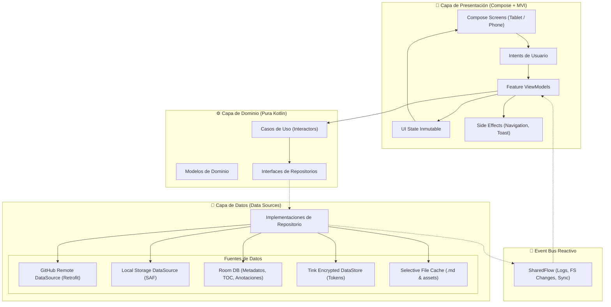

# Arquitectura del Sistema — MD GitHub Navigator

Este documento describe la arquitectura técnica, los patrones de diseño y los componentes principales de **MD GitHub Navigator**.

---

## 1. Visión General de la Arquitectura

La aplicación está diseñada siguiendo los principios de **Clean Architecture** estructurada bajo el patrón **MVI (Model-View-Intent)** con un bus de eventos reactivo para la propagación de logs y eventos del sistema de archivos.



---

## 2. Principios Fundamentales

1. **Separación de Responsabilidades**: La capa de dominio no tiene ninguna dependencia del SDK de Android, permitiendo pruebas unitarias instantáneas con JUnit 5 y MockK.
2. **Flujo Unidireccional de Datos (UDF)**:
   - Las pantallas emiten **Intents** al ViewModel.
   - El ViewModel procesa los casos de uso y emite un nuevo **UI State** inmutable.
   - Los eventos de un solo uso (navegación, alertas) se emiten como **Effects** a través de canales de Kotlin Coroutines.
3. **Event-Driven**: Cualquier cambio detectado en repositorios remotos o directorios locales genera eventos en un `SharedFlow` central, lo que permite registrar logs estructurados en tiempo real y actualizar vistas desacopladas.
4. **Caché Inteligente y Selectivo**: El sistema sólo descarga y cachea archivos `.md` y los activos que éstos enlazan explícitamente (imágenes, hojas de estilo locales). Los binarios ajenos permanecen accesibles vía web sin saturar el almacenamiento de la tablet.

---

## 3. Modularización Propuesta

```
:app
├── :core:common          # Extensiones, Dispatchers, EventBus
├── :core:designsystem    # Tema "Scholar", paletas M3, componentes base
├── :core:network         # Cliente Retrofit, interceptores, Certificate Pinning
├── :core:database        # Entidades y DAOs de Room
├── :core:datastore       # Almacenamiento cifrado con Google Tink
├── :core:renderer        # Motor híbrido Compose-WebView para Markdown y Diagramas
├── :feature:library      # Gestión de repositorios GitHub y carpetas locales
├── :feature:reader       # Visor Markdown, zoom, tracking de scroll y lectura
├── :feature:navigator    # Índice / Tabla de Contenidos (TOC) y buscador
├── :feature:annotations  # Subrayados, notas y exportación
├── :feature:settings     # Preferencias de lectura, temas y limpieza de caché
└── :feature:tts          # Motor Text-to-Speech nativo
```

---

## 4. Motor de Renderizado Híbrido

Para dar soporte a diagramas avanzados (**Mermaid**, **Graphviz/Viz.js**, **D2/WASM**, **Excalidraw** y fórmulas **KaTeX**), la aplicación utiliza un lienzo web local aislado incrustado en Jetpack Compose mediante `AndroidView`:

- **Sin dependencias de CDN externo:** Todos los scripts de renderizado se distribuyen localmente en la carpeta `assets/` del APK.
- **Puente JavaScript Bidireccional (`@JavascriptInterface`):**
  - **JS -> Android:** Notifica la posición del scroll porcentual, eventos de clic en hipervínculos, selección de texto para anotaciones y clics en imágenes para visualización a pantalla completa.
  - **Android -> JS:** Inyecta estilos CSS acordes al tema activo (Scholar, Paper, Neon Dev), tamaño de fuente configurado y comandos de navegación a encabezados.

---

## 5. Estrategia de Internacionalización (i18n) — (Fase 4 / v0.4.0)

La aplicación implementa una arquitectura de localización nativa y escalable:
1. **Resolución Jerárquica de Idiomas:**
   - **Idioma del Sistema:** Android resuelve dinámicamente los recursos con `stringResource(R.string.*)` según el `Locale` del dispositivo.
   - **Fallback a Inglés:** El calificador base `res/values/strings.xml` contiene las cadenas en inglés (`en`). Cualquier idioma del sistema sin traducción personalizada recurre transparentemente al inglés.
   - **Soporte Inicial:** Español (`res/values-es/strings.xml`) e Inglés (`res/values/strings.xml`).
2. **Preferencia de Idioma por Aplicación (Per-App Language):**
   - Soporte nativo de la API de Android 13+ (`android.app.LocaleManager`) y `AppCompatDelegate.setApplicationLocales` para que el usuario pueda alternar entre español e inglés desde la pantalla de *Ajustes* (`:feature:settings`) sin alterar la configuración del sistema.
3. **Externalización y Mantenibilidad:**
   - Cero cadenas literales en código Kotlin/Compose. Todos los módulos de presentación (`:feature:*` y `:core:designsystem`) delegan en identificadores de recursos XML compilados.
