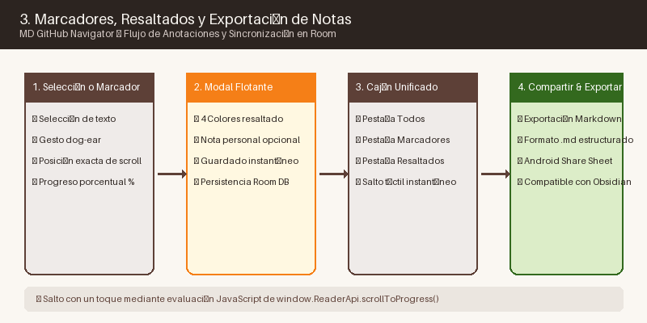
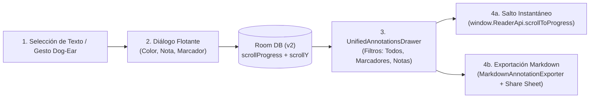

# Anotaciones, Resaltados y Marcadores

**MD GitHub Navigator** te permite interactuar activamente con la documentación técnica tomando notas y guardando puntos de interés.

---

## 1. Marcadores Rápidos (Bookmarks)

- **Gesto de Esquina (Dog-Ear):** Pulsa en la esquina superior derecha del documento de lectura para añadir o quitar un marcador rápido.
- **Acceso Centralizado:** En el panel de navegación puedes consultar todos tus marcadores ordenados por fecha o por capítulo para volver a ellos en un solo clic.

---

## 2. Resaltados y Notas

- **Selección de Texto:** Mantén pulsado y arrastra sobre el texto que desees resaltar.
- **Barra de Acciones Flotante:**
  - **Paleta de Colores:** Selecciona un color (amarillo cálido, verde menta, sepia o rosa suave).
  - **Añadir Nota:** Escribe comentarios o reflexiones sobre el fragmento seleccionado.
- **Visualización:** El texto resaltado se muestra con un fondo suave que no interfiere con la lectura. Tocar el resaltado abrirá una tarjeta desplegable con tu nota asociada.

---

## 3. Exportación de Notas

- Todas tus notas y fragmentos destacados pueden exportarse a un único archivo `.md` compatible con herramientas como **Obsidian**, **Logseq** o **Notion**, o compartirse mediante la hoja de compartir nativa de Android.
