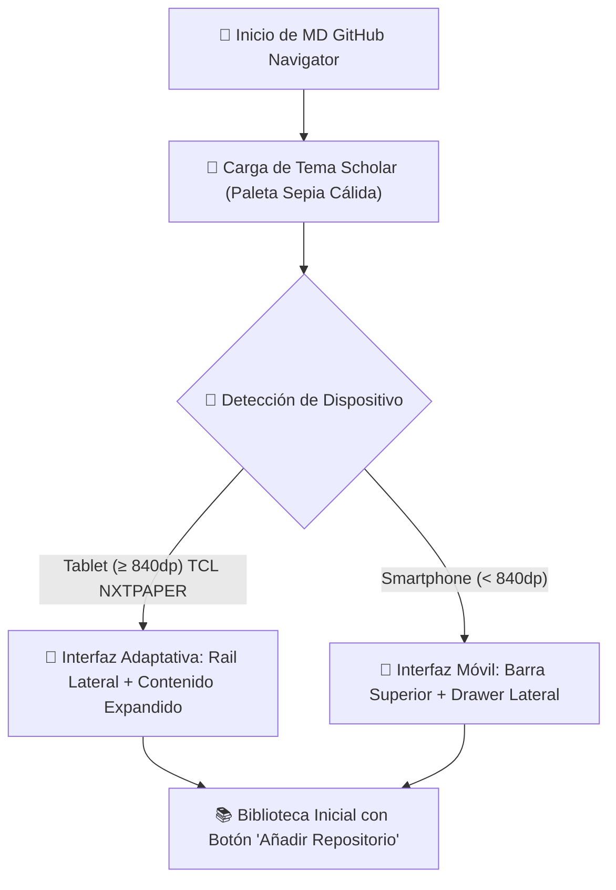
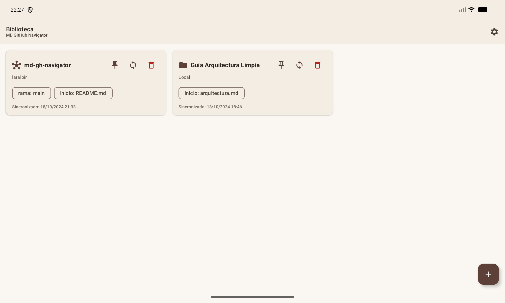
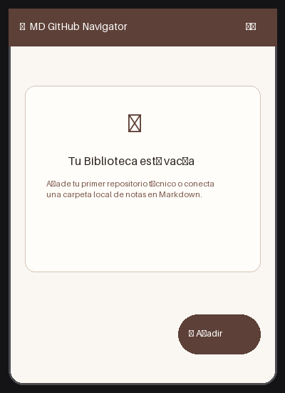

# Primeros Pasos — MD GitHub Navigator

Bienvenido a **MD GitHub Navigator**, el lector tipo eReader para repositorios técnicos y libros en Markdown.

---

## 1. Requisitos del Dispositivo

- **Sistema Operativo:** Android 7.0 (API 24) o superior (optimizado para Android 15/16).
- **Dispositivo recomendado:** Tablets con ratio de lectura cómodo (por ejemplo, TCL NXTPAPER 11 Plus) y smartphones modernos.
- **Espacio en disco:** La caché selectiva sólo almacena ficheros `.md` e imágenes, consumiendo generalmente menos de 50 MB por repositorio.

---

## 2. Instalación de la Aplicación

Puedes instalar la aplicación mediante dos métodos oficiales:

### Opción A: Desde Google Play Store
1. Busca **MD GitHub Navigator** en la tienda de Google Play en tu tablet o smartphone.
2. Pulsa en **Instalar**. Las actualizaciones se gestionarán automáticamente.

### Opción B: Descarga Directa desde GitHub Releases (Sideloading)
Ideal para dispositivos sin servicios de Google Play, ROMs alternativas o e-readers específicos:
1. Accede a la sección de [Releases en GitHub](https://github.com/laralbir/md-gh-navigator/releases/latest).
2. Descarga el archivo `app-universal-release.apk` (o la variante correspondiente a tu arquitectura).
3. Opcional: Verifica la integridad del instalador mediante el archivo `.sha256` proporcionado.
4. Abre el archivo descargado en tu dispositivo y confirma la instalación (habilita la opción de *Instalar aplicaciones de fuentes desconocidas* si el sistema te lo solicita).
5. La app incluye un comprobador integrado que te avisará en *Ajustes* cuando se publique una nueva versión en GitHub.

---

### 3.1 Flujo Visual de Inicio

*Figura 1: Vista panorámica inicial en tablet TCL NXTPAPER 11 Plus con tema Scholar activo y panel de bienvenida.*

*Figura 2: Disposición compacta en smartphone con acceso directo al botón flotante de adición.*

---

## 4. Navegación Rápida

- **Barra de navegación / Rail lateral (Tablet):** Permite cambiar entre la *Biblioteca*, los *Documentos Recientes*, los *Marcadores & Anotaciones* y los *Ajustes*.
- **Pantalla completa de lectura:** Toca en el centro de cualquier documento abierto para mostrar u ocultar la barra superior y los controles de lectura.
- **Transición de temas táctil:** Con un solo toque en el selector de paleta puedes alternar entre *Scholar* (cálido), *Paper* (minimalista e-ink) o *Neon Dev* (desarrollador de alto contraste).
