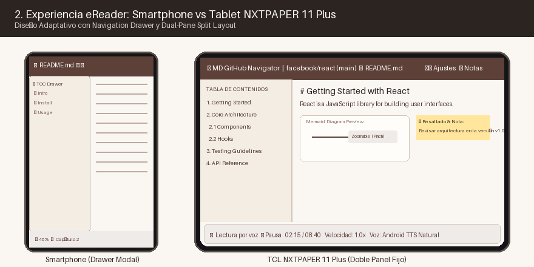
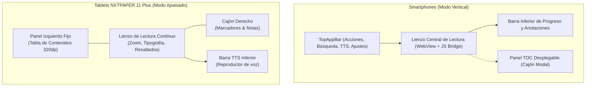

# Lectura y Navegación — Experiencia eReader

**MD GitHub Navigator** emula la experiencia de lectura de los mejores dispositivos de tinta electrónica y lectores profesionales (Kobo, Nickel, Kindle).

---

## 1. Lienzo de Lectura y Controles

- **Modo Inmersivo:** Toca el centro de la pantalla para alternar entre la vista a pantalla completa (sin distracciones) y la visualización de la barra superior de acciones y la barra inferior de progreso.
- **Progreso de Lectura:**
  - La aplicación registra automáticamente en qué documento del repositorio te encuentras y la posición exacta del scroll porcentual.
  - Al reabrir cualquier repositorio, volverás de inmediato a tu último punto de lectura.
- **Ajuste de Brillo y Tamaño de Fuente:**
  - Desliza verticalmente por el borde izquierdo para atenuar o incrementar el brillo.
  - Usa el menú de tipografía para cambiar el tamaño de fuente, interlineado y familia tipográfica (Serif, Sans, Monospace).

---

## 2. Índice y Tabla de Contenidos (TOC)

- **Panel Desplegable (Smartphones):** Desliza desde el lateral izquierdo o pulsa el icono de índice (📑) para desplegar el árbol de documentos y secciones del repositorio.
- **Doble Panel Permanente (Tablets tipo TCL NXTPAPER 11 Plus):** En pantallas grandes, el panel izquierdo de navegación permanece accesible o se colapsa con un solo toque, permitiendo saltar ágilmente entre capítulos y documentos.
- **Caché del Índice:** El índice del repositorio se guarda en base de datos local para que la navegación sea instantánea, incluso sin conexión a Internet.

---

## 3. Renderizado de Diagramas e Imágenes

- **Diagramas Técnicos:** Los diagramas de arquitecturas creados con **Mermaid**, **Graphviz**, **D2** o **Excalidraw** se renderizan localmente con gran nitidez.
- **Zoom de Imágenes:**
  - Toca dos veces sobre cualquier imagen o diagrama para ampliarlo.
  - Utiliza el gesto de pellizcar (pinch-to-zoom) para inspeccionar diagramas complejos al detalle.
- **Enlaces Web:** Los enlaces externos se abren de forma segura en el navegador web predeterminado de tu dispositivo.
