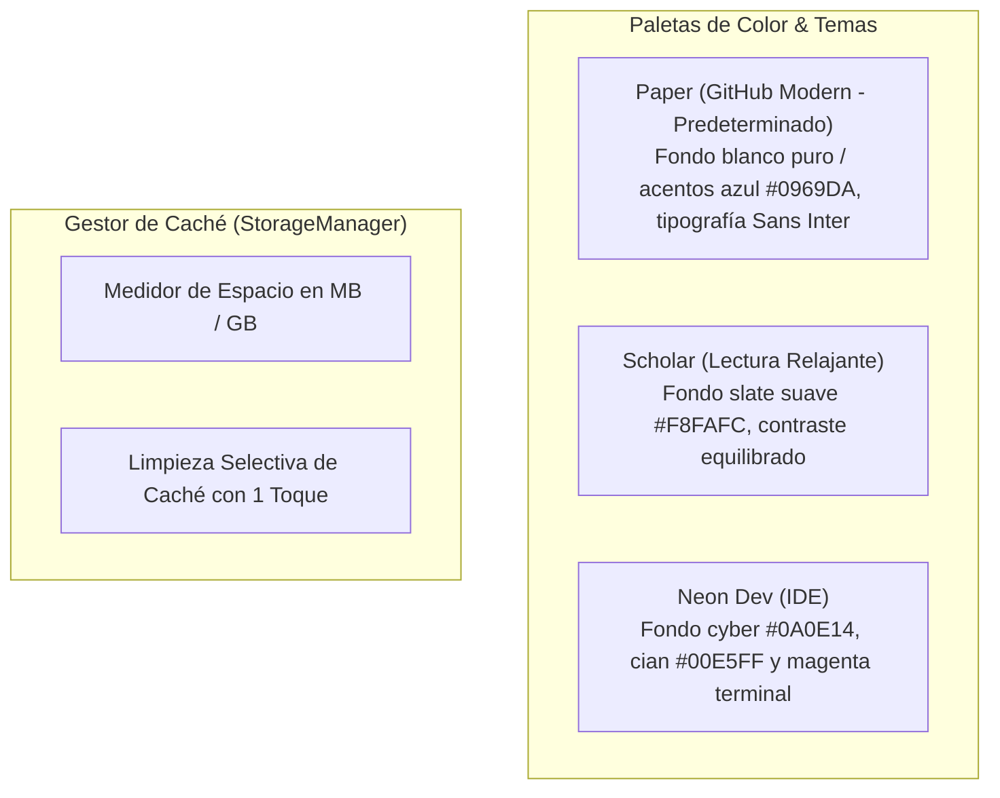

# Ajustes y Personalización

Personaliza la apariencia y el comportamiento de la app según tus preferencias de lectura y el tipo de pantalla de tu dispositivo.

---

## 1. Temas de Visualización

- **Paper / GitHub Modern (Predeterminado):** Estilo nítido de alto contraste con fondo blanco puro y acentos azules modernos, máxima legibilidad técnica e inspirado en GitHub y Notion.
- **Scholar (Lectura Relajante):** Diseñado con un fondo suave de contraste reducido, ideal para sesiones prolongadas de estudio o pantallas mate como **TCL NXTPAPER 11 Plus**.
- **Neon Dev:** Tema oscuro con acentos de color vibrantes para quienes prefieren la estética de un editor de código moderno.
- **Modo del Sistema:** Alterna automáticamente entre Claro y Oscuro según la configuración de Android.

---

## 2. Ajustes de Tipografía y Maquetación

- **Familia Tipográfica:**
  - *Serif:* Literata / Merriweather (lectura prolongada de prosa técnica).
  - *Sans:* Inter / Roboto (alta nitidez y diseño limpio).
  - *Monospace:* JetBrains Mono (para bloques de código y especificaciones).
- **Tamaño de Letra e Interlineado:** Regulador continuo para adaptar el tamaño a la distancia de visualización.
- **Ancho del Margen:** Permite estrechar o ensanchar la columna de lectura en tablets.

---

## 3. Gestión de Caché y Almacenamiento

- **Panel de Espacio:** Visualiza cuántos megabytes ocupa cada repositorio sincronizado.
- **Limpieza de Caché:** Borra imágenes cacheadas o documentos antiguos sin perder tus notas ni tu progreso de lectura.
