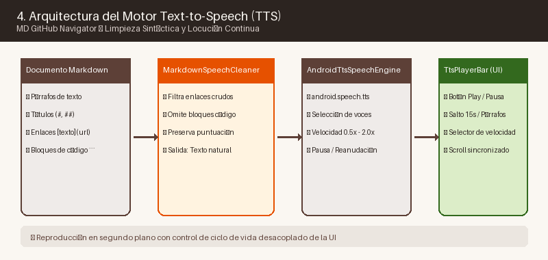
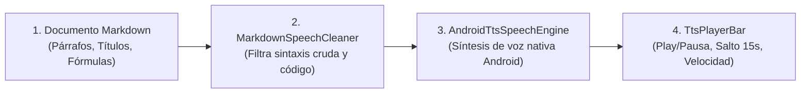

# Lectura en Voz Alta (Text-to-Speech)

**MD GitHub Navigator** integra el motor de síntesis de voz nativo de Android para permitirte escuchar libros y artículos técnicos mientras descansas la vista o te desplazas.

---

## 1. Cómo Iniciar la Lectura por Voz

1. Mientras estás en un documento, pulsa el icono de audio (🔊) en la barra superior o en el menú de acciones rápidas.
2. La reproducción comenzará automáticamente desde el párrafo visible en pantalla.
3. El párrafo que se está leyendo se resaltará visualmente en el documento, acompañando el avance del audio con un desplazamiento suave.

---

## 2. Controles de Reproducción

- **Barra Flotante de Audio:** Controles de Reproducir/Pausa, Retroceder 15 segundos y Avanzar al siguiente encabezado o párrafo.
- **Velocidad de Lectura:** Ajusta el ritmo de la locución desde `0.75x` hasta `2.0x`.

---

## 3. Descarga e Idiomas de Voces

- La aplicación utiliza las voces instaladas en el sistema Android (Google Speech Services / síntesis del fabricante).
- Si necesitas una voz más natural o en otro idioma, pulsa en *Configurar Voces* para abrir directamente los ajustes de síntesis de voz de Android y descargar paquetes de alta calidad offline.
